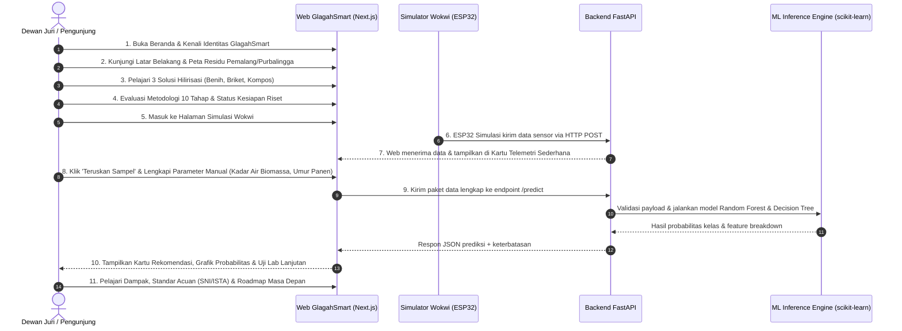
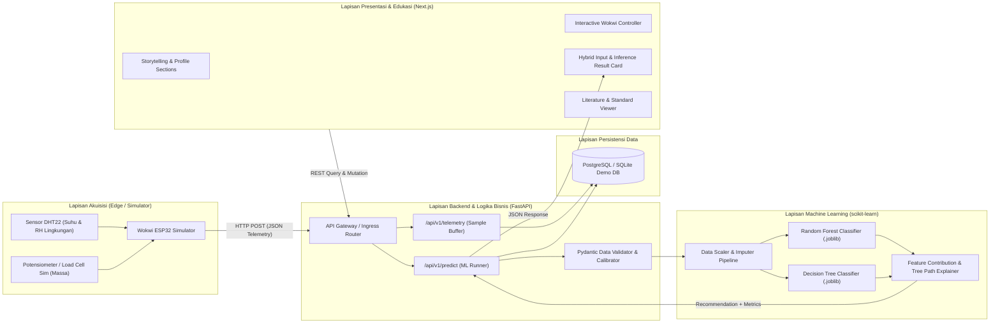
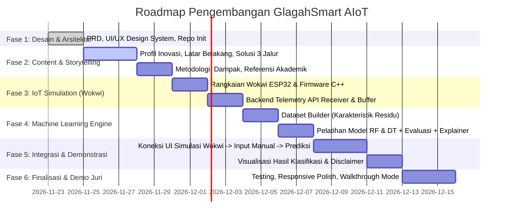

# Dokumen Perancangan Sistem & PRD: GlagahSmart AIoT
**IDTC 2.0 – AIoT Future Competition 2026**
*Project Profiling & Interactive AIoT Demonstration Platform*

---

## 1. Product Requirements Document (PRD)

### 1.1 Ringkasan Eksekutif (Executive Summary)
**GlagahSmart AIoT** (*Smart Classification for Sustainable Glagah Utilization*) adalah platform web profil inovasi berbasis riset yang dirancang untuk memperkenalkan solusi teknologi AIoT dalam mengoptimalkan pemanfaatan residu tanaman glagah (*Saccharum spontaneum*) di sentra industri sapu tradisional Kabupaten Pemalang dan Kabupaten Purbalingga, Jawa Tengah.

Fokus utama produk adalah **Project Profiling & Scientific Storytelling** yang dilengkapi dengan **Demonstrasi Interaktif Dua Arah**:
1. Simulasi akuisisi data sensor mikrokontroler ESP32 via simulator Wokwi.
2. Klasifikasi rekomendasi pemanfaatan berbasis Machine Learning tabular (*scikit-learn*) secara transparan dan akuntabel.

Platform ini sengaja tidak dirancang sebagai *dashboard monitoring* operasional, melainkan sebagai media presentasi ilmiah-interaktif tingkat kompetisi untuk dewan juri, akademisi, petani, pengrajin sapu, dan pelaku ekonomi sirkular.

---

### 1.2 Pernyataan Masalah & Konteks Lapangan
1. **Limbah Residu yang Tidak Termanfaatkan:** Proses sortasi dan perontokan bunga glagah menghasilkan residu masif (serbuk rontokan bunga, spikelet malai yang rapuh, dan tangkai cacat) yang selama ini hanya dibakar atau dibuang.
2. **Ketiadaan Standar Penilaian Cepat:** Petani dan pengrajin tidak memiliki alat ukur objektif untuk menentukan apakah suatu kelompok residu layak dijadikan benih pemuliaan, bahan briket biomassa berkalori tinggi, atau bahan kompos organik.
3. **Kekeliruan Pengukuran Fisik:** Sering terjadi kerancuan antara kelembapan udara lingkungan (*ambient relative humidity*) dan kadar air internal biomassa (*biomass moisture content*), yang mengakibatkan kegagalan proses briketasi atau fermentasi kompos.
4. **Kebutuhan Media Diseminasi Terbuka:** Hasil riset agriteknologi sering kali terkubur dalam laporan PDF teknis tanpa visualisasi yang mudah dipahami oleh pengambil keputusan dan dewan juri kompetisi.

---

### 1.3 Value Proposition & Sasaran Inovasi
* **Pemberdayaan Ekonomi Sirkular:** Mengubah limbah berbiaya nol menjadi 3 aliran nilai ekonomi: **Benih (Perbanyakan)**, **Briket Biomassa (Energi)**, dan **Pupuk Kompos (Pertanian Organik)**.
* **Integritas Ilmiah Transparan:** Pemisahan tegas antara data observasi lapangan, data simulasi Wokwi, dan hipotesis riset. Status kesiapan model ML ditampilkan secara jujur (*validated vs baseline*).
* **AIoT Berbasis Data Numerik yang Ringkas & Relevan:** Menghindari *overengineering* (tidak menggunakan Deep Learning/Computer Vision yang boros komputasi untuk data yang secara alamiah merupakan parameter fisik-kimia numerik).

---

### 1.4 Ruang Lingkup (Scope & Boundaries)
| Termasuk dalam Lingkup (In-Scope) | Di Luar Lingkup (Out-of-Scope) |
| :--- | :--- |
| Halaman profil riset interaktif (Latar belakang, identifikasi masalah, metodologi, dampak, tim). | Dashboard monitoring telemetry IoT real-time skala industri 24/7. |
| Integrasi simulasi Wokwi ESP32 untuk pembacaan parameter fisik & pengiriman via HTTP REST API. | Penggunaan Computer Vision atau Deep Learning Convolutional Neural Networks (CNN). |
| Formulir input manual untuk parameter laboratorium/lapangan (kadar air biomassa terkalibrasi, umur panen, kondisi biji). | Kontrol aktuator otomatis atau sistem robotik pemilahan mekanis. |
| Model Machine Learning tabular (Random Forest & Decision Tree) via backend Python/scikit-learn. | Transaksi komersial / marketplace penjualan produk biomassa. |
| Penjelasan faktor penentu keputusan (*explainability*) dan rekomendasi uji laboratorium lanjutan. | Panel multi-tenant administrator atau autentikasi pengguna yang rumit. |

---

## 2. Functional & Non-Functional Requirements

### 2.1 Functional Requirements (FR)

#### FR-01: Profiling & Scientific Storytelling
* **FR-01.1:** Sistem harus menyajikan visual storytelling modern mengenai ekosistem glagah Pemalang & Purbalingga dengan hierarki fakta berlabel: `[Fakta Terverifikasi]`, `[Hasil Observasi Lapangan]`, dan `[Hipotesis Riset]`.
* **FR-01.2:** Sistem harus menyediakan kartu interaktif untuk 3 alternatif hilirisasi residu glagah (Benih, Briket Biomassa, Pupuk Kompos) yang mencakup parameter penentu, potensi nilai ekonomi, dan syarat uji lanjutan.
* **FR-01.3:** Sistem harus menampilkan roadmap metodologi penelitian 10 tahap dengan status pelaksanaan dinamis (`Selesai`, `Berlangsung`, `Direncanakan`).

#### FR-02: Wokwi IoT Data Acquisition Simulation
* **FR-02.1:** Sistem harus menyediakan embed interaktif atau tautan langsung ke simulasi Wokwi ESP32 dengan sensor suhu & kelembapan DHT22 serta potensiometer simulasi massa/kadar air.
* **FR-02.2:** Backend harus menyediakan endpoint REST API `POST /api/v1/telemetry/sample` untuk menerima payload data simulasi dari ESP32 Wokwi.
* **FR-02.3:** Halaman simulasi harus menampilkan kartu data pembacaan sensor terakhir (timestamp, suhu lingkungan, kelembapan udara relatif, perkiraan massa, dan status konektivitas simulator).
* **FR-02.4:** Halaman simulasi harus memiliki tombol aksi *"Teruskan Sampel ke Klasifikasi"* untuk memindahkan data sensor secara instan ke formulir klasifikasi ML.

#### FR-03: Machine Learning Classification & Hybrid Input
* **FR-03.1:** Sistem harus menyediakan form hibrida yang menerima parameter sensor otomatis (dari Wokwi) dan parameter manual yang wajib diisi pengguna:
  - *Suhu Lingkungan (°C)* & *Kelembapan Udara (% RH)* (dari Wokwi/manual).
  - *Massa Sampel (gram)* (dari Wokwi/manual).
  - *Kadar Air Biomassa (% MC)* (input manual terkalibrasi dengan batas validasi 5% – 80%).
  - *Umur Pascapanen (Hari)* (input manual 1 – 60 hari).
  - *Kondisi Fisik Biji / Bunga* (kategori: Utuh Berkecambah, Kering Berserbuk, Terdegradasi/Basah).
* **FR-03.2:** Backend harus mengeksekusi model *Random Forest Classifier* (algoritma utama) dan *Decision Tree* (pembanding) melalui endpoint `POST /api/v1/predict`.
* **FR-03.3:** Sistem harus menampilkan hasil rekomendasi:
  - Kelas Utama yang direkomendasikan (*Benih*, *Briket Biomassa*, atau *Pupuk Kompos*).
  - Persentase probabilitas kecocokan masing-masing alternatif.
  - Penjelasan faktor kritis (*feature contribution breakdown*, misalnya: *"Kadar air 11.5% mendukung pembriketan tanpa pengeringan ulang"*).
  - Peringatan batas validasi (*Disclaimer* keterbatasan model numerik).
* **FR-03.4:** Jika model terverifikasi laboratorium belum tersedia, sistem wajib menampilkan badge transparan `[Demo/Baseline Model]` dan tidak mengklaim akurasi fiktif.

#### FR-04: Literature & Documentation Repository
* **FR-04.1:** Sistem harus menyediakan repositori referensi akademik (SNI Briket Biomassa, ISTA Rules untuk pengujian benih, parameter rasio C/N kompos, dan jurnal agriteknologi lokal).

---

### 2.2 Non-Functional Requirements (NFR)

* **NFR-01 (Kinerja & Responsivitas):** Waktu respon inferensi ML dan kalkulasi API tidak boleh melebihi 300 ms untuk satu sampel data. Skor Lighthouse Performance > 90 pada koneksi broadband standar.
* **NFR-02 (UI/UX & Desain Adaptif):** Tampilan responsif sempurna pada viewport smartphone (360px) hingga layar proyektor presentasi 4K (3840px). Mengikuti identitas palet warna: Deep Forest Green (`#166534`), Fresh Emerald (`#10B981`), Off-White Canvas (`#F8FAF8`), Dark Charcoal (`#14251B`), dan Warning/Accent Amber (`#F59E0B`).
* **NFR-03 (Scientific Integrity & Transparency):** Wajib memberi penanda jelas bahwa kadar air biomassa (*moisture content*) berbeda secara fisis dari kelembapan udara relatif (*relative humidity*). Tidak ada data simulasi yang diklaim sebagai data empiris laboratorium.
* **NFR-04 (Kemudahan Deployment & Portabilitas Demo):** Sistem dapat dijalankan secara lokal dalam satu perintah (*docker-compose* atau script dev lokal) untuk menjamin kelancaran saat sesi demo penjurian tanpa ketergantungan koneksi internet yang tidak stabil.
* **NFR-05 (Aksesibilitas & Standar Kode):** Standar aksesibilitas WCAG 2.1 Level AA (kontras rasio warna teks minimum 4.5:1), struktur kode berbasis TypeScript strict mode pada frontend dan type-hinted Pydantic pada backend.

---

## 3. Sitemap dan User Flow

### 3.1 Sitemap GlagahSmart AIoT

```mermaid
flowchart TD
    Root["/ (Beranda / Hero & Innovation Pitch)"]
    
    Root --> Sub1["/background (Latar Belakang & Potensi Glagah)"]
    Root --> Sub2["/problem (Identifikasi Masalah & Rantai Pasok)"]
    Root --> Sub3["/objectives (Tujuan, Sasaran & SDGs)"]
    Root --> Sub4["/solution (Solusi GlagahSmart: 3 Jalur Hilirisasi)"]
    Root --> Sub5["/research (Metodologi Penelitian 10 Tahap)"]
    Root --> Sub6["/simulation (Wokwi IoT Data Acquisition Demo)"]
    Root --> Sub7["/classification (Demonstrasi ML: Random Forest vs DT)"]
    Root --> Sub8["/technology (Arsitektur Sistem & Spesifikasi AIoT)"]
    Root --> Sub9["/impact (Manfaat, Analisis Nilai Tambah & Batasan)"]
    Root --> Sub10["/references (Katalog Standar SNI & Riset Rujukan)"]
    Root --> Sub11["/about (Tim Peneliti, Kompetisi IDTC 2.0 & Roadmap)"]
```



> **Catatan UX:** Untuk kemudahan navigasi dewan juri, struktur ini dapat diakses secara modular baik sebagai *single-page smooth scroll* terpadu dengan sticky header navigation maupun halaman terpisah (*dynamic routing* Next.js App Router).

---

### 3.2 User Flow: Skenario Presentasi Dewan Juri (11 Langkah)



---

## 4. Rekomendasi Arsitektur Sistem

Arsitektur dirancang dengan pola **Decoupled Edge-Cloud/Backend AIoT Architecture**, memastikan isolasi yang bersih antara akuisisi data, engine pemrosesan analitik, dan presentasi antarmuka pengguna.



---

## 5. Rekomendasi Tech Stack & Justifikasi

| Lapisan | Teknologi | Justifikasi Teknis |
| :--- | :--- | :--- |
| **Frontend Framework** | **Next.js 14/15 (App Router, TypeScript)** | Server-side rendering (SSR) optimal untuk profil inovasi dan SEO, client components interaktif untuk kalkulator dan visualisasi, serta keandalan type safety. |
| **Styling & UI Kit** | **Tailwind CSS + shadcn/ui** | Desain modular, modern, dan sangat konsisten. Menggunakan komponen yang mudah dikustomisasi sesuai palet warna alam-teknologi tanpa bloatware CSS. |
| **Icons & Animasi** | **Lucide React + Framer Motion** | Ikon clean bernuansa agritech dan transisi visual halus untuk infografis alur produksi sapu dan kartu perbandingan. |
| **Backend Framework** | **Python FastAPI** | Asynchronous, performa sangat tinggi, integrasi langsung tanpa jembatan (*native*) dengan library scikit-learn dan NumPy, serta dokumentasi Swagger/OpenAPI otomatis. |
| **Data Validation** | **Pydantic v2** | Memvalidasi parameter fisik (suhu, RH, kelembapan biomassa) secara ketat sebelum diteruskan ke model Machine Learning. |
| **Machine Learning** | **scikit-learn, Pandas, NumPy, Joblib** | Pilihan tepat untuk data tabular numerik. Mengimplementasikan Random Forest & Decision Tree dengan kalkulasi feature importances yang ringan, transparan, dan dapat diexplain tanpa black-box. |
| **Database** | **PostgreSQL (Prod) / SQLite (Portable Demo)** | Menyimpan log pembacaan sensor simulasi dan riwayat prediksi. SQLite memudahkan juri atau panitia menjalankan sistem secara offline. |
| **IoT Simulator** | **Wokwi Simulator (ESP32 C++)** | Simulator mikroelektronika standar industri modern. Mampu menjalankan kode C++ Arduino/ESP-IDF nyata dan mengirim HTTP request ke backend lokal melalui Wokwi Bridge atau webhook publik. |

---

## 6. Struktur Folder Proyek

```text
glagahsmart-aiot/
├── README.md                           # Dokumentasi umum proyek & panduan juri
├── docker-compose.yml                  # Konfigurasi container backend + database
│
├── frontend/                           # Aplikasi Next.js App Router
│   ├── package.json
│   ├── tsconfig.json
│   ├── tailwind.config.ts
│   ├── public/
│   │   ├── images/                     # Aset foto residu glagah, diagram, & logo
│   │   └── data/                       # Dokumen acuan PDF & JSON referensi
│   ├── src/
│   │   ├── app/
│   │   │   ├── layout.tsx              # Root layout dengan Header & Footer
│   │   │   ├── page.tsx                # Halaman Beranda (Hero & Ringkasan Inovasi)
│   │   │   ├── background/page.tsx     # Latar Belakang & Potensi Pemalang-Purbalingga
│   │   │   ├── problem/page.tsx        # Identifikasi Masalah & Infografis Sapu
│   │   │   ├── objectives/page.tsx     # Tujuan, Sasaran & Target Pengguna
│   │   │   ├── solution/page.tsx       # Solusi 3 Jalur: Benih, Briket, Kompos
│   │   │   ├── research/page.tsx       # Metodologi 10 Tahap & Status Riset
│   │   │   ├── simulation/page.tsx     # Halaman Simulasi Wokwi & Kartu Sensor
│   │   │   ├── classification/page.tsx # Halaman Demonstrasi Machine Learning
│   │   │   ├── technology/page.tsx     # Arsitektur AIoT & Diagram Kerja
│   │   │   ├── impact/page.tsx         # Manfaat, Nilai Tambah & Batasan Riset
│   │   │   ├── references/page.tsx     # Standar SNI, ISTA & Riset Terkait
│   │   │   └── about/page.tsx          # Tim Pengembang & Profil IDTC 2.0
│   │   ├── components/
│   │   │   ├── ui/                     # Komponen shadcn/ui (Button, Card, Badge, Dialog)
│   │   │   ├── layout/                 # Navbar, MobileNav, Footer
│   │   │   ├── sections/               # Section components yang reusable
│   │   │   ├── simulation/             # Kartu telemetri Wokwi & bridge status
│   │   │   └── ml/                     # Form klasifikasi, bar probabilitas, radar chart
│   │   └── lib/
│   │       ├── api.ts                  # Axios/Fetch client ke FastAPI backend
│   │       ├── types.ts                # TypeScript interfaces (Telemetry, Prediction, etc.)
│   │       └── constants.ts            # Konstanta acuan fisik & palet warna
│
├── backend/                            # REST API FastAPI & Machine Learning Service
│   ├── requirements.txt
│   ├── main.py                         # FastAPI application entrypoint
│   ├── config.py                       # Pengaturan environment & CORS
│   ├── api/
│   │   └── v1/
│   │       ├── endpoints/
│   │       │   ├── telemetry.py        # Receiver endpoint Wokwi ESP32
│   │       │   ├── predict.py          # Endpoint klasifikasi Machine Learning
│   │       │   └── health.py           # Health check endpoint
│   │       └── router.py
│   ├── core/
│   │   ├── schemas.py                  # Pydantic schemas (SampleInput, PredictionOutput)
│   │   └── database.py                 # SQLAlchemy engine & session maker
│   ├── ml/
│   │   ├── train.py                    # Script pelatihan & perbandingan model (RF vs DT)
│   │   ├── evaluate.py                 # Evaluasi metrik (Precision, Recall, F1, Confusion Matrix)
│   │   ├── dataset_generator.py        # Sintesis dataset berbasis acuan literatur & domain rule
│   │   ├── models/                     # Tempat penyimpanan binary model (.joblib)
│   │   │   ├── random_forest_model.joblib
│   │   │   ├── decision_tree_model.joblib
│   │   │   └── feature_scaler.joblib
│   │   └── inference.py                # Wrapper loader & decision explainer
│   └── tests/                          # Unit testing API dan inferensi ML
│
├── simulation/                         # Kode Firmware Simulasi Wokwi ESP32
│   ├── diagram.json                    # Konfigurasi rangkaian Wokwi (ESP32, DHT22, Resistor)
│   ├── wokwi-project.txt               # Link proyek & metadata simulator
│   └── esp32_glagah_node.ino           # Firmware Arduino/ESP32: Baca sensor & kirim JSON HTTP
│
└── docs/                               # Dokumentasi Riset & Panduan Juri
    ├── research_notes.md               # Catatan parameter fisik & kimia residu glagah
    ├── sni_standards.md                # Ringkasan SNI Briket & Parameter Kompos
    └── competition_pitch.md            # Naskah presentasi & panduan navigasi dewan juri
```

---

## 7. Rencana Pengembangan Bertahap (Phased Roadmap)



### Rincian Setiap Fase:

1. **Fase 1: Desain Fondasi & Inisialisasi Repositori**
   - Menetapkan Design System (palet warna `#166534`, typography Plus Jakarta Sans, card borders, badge style).
   - Inisialisasi project workspace (`frontend` Next.js TypeScript, `backend` FastAPI Python).
2. **Fase 2: Pembuatan Halaman Profil Inovasi & Edukasi Riset**
   - Implementasi komponen Beranda (*Hero*, *Value Proposition*, *Call-to-Action*).
   - Penyusunan halaman edukatif: Latar Belakang Pemalang/Purbalingga, Diagram Alur Proses Sapu Tradisional, Identifikasi Residu, 3 Alternatif Hilirisasi (Benih, Briket, Kompos), Metodologi 10 Tahap, dan Referensi Standar SNI/ISTA.
3. **Fase 3: Simulasi Akuisisi Data IoT (Wokwi & Backend Ingress)**
   - Perancangan rangkaian Wokwi (ESP32 + DHT22 + Potensiometer simulasi massa).
   - Penulisan firmware ESP32 untuk formatting JSON dan transmisi data via HTTP POST.
   - Pembuatan endpoint `POST /api/v1/telemetry/sample` dan buffer kartu status di frontend.
4. **Fase 4: Pipeline Machine Learning Tabular (Random Forest vs Decision Tree)**
   - Sintesis dataset berbasis batasan fisik ilmiah (standar kadar air briket < 15%, suhu ruang, kondisi viabilitas benih, massa jenis).
   - Pelatihan model Random Forest & Decision Tree menggunakan *scikit-learn*.
   - Penyimpanan artefak model `.joblib` dan pembuatan fungsi *explainability* kontribusi fitur.
5. **Fase 5: Demonstrasi Interaktif Hibrida (Wokwi -> Form Manual -> Prediksi)**
   - Mengintegrasikan tombol aksi pengiriman sampel dari halaman Wokwi ke formulir klasifikasi.
   - Menyediakan input manual untuk parameter laboratorium (kadar air biomassa terkalibrasi dan umur panen).
   - Menampilkan visualisasi hasil prediksi: bar chart probabilitas 3 kelas, badge status model, dan rekomendasi uji lab lanjutan.
6. **Fase 6: Pengujian, Polish Presentasi Dewan Juri, & Dokumentasi**
   - Uji responsivitas desktop, tablet, dan smartphone.
   - Pengecekan ketat integritas ilmiah: memastikan pembedaan kadar air vs kelembapan udara tertera dengan tegas.
   - Penyusunan panduan demonstrasi cepat (*quick walkthrough guide*) untuk dewan juri kompetisi IDTC 2.0.
